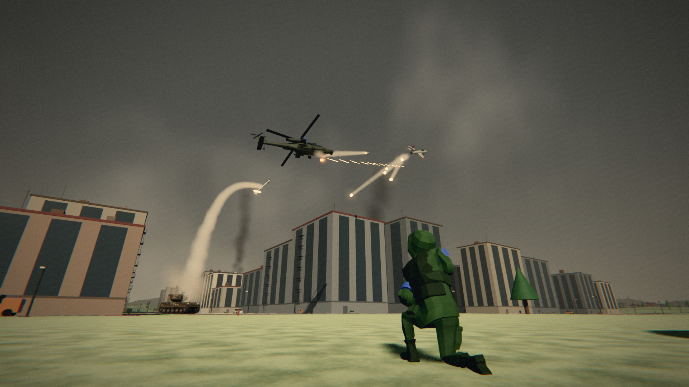
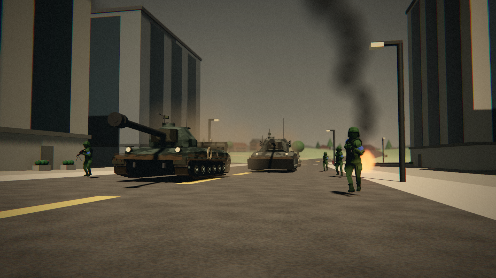
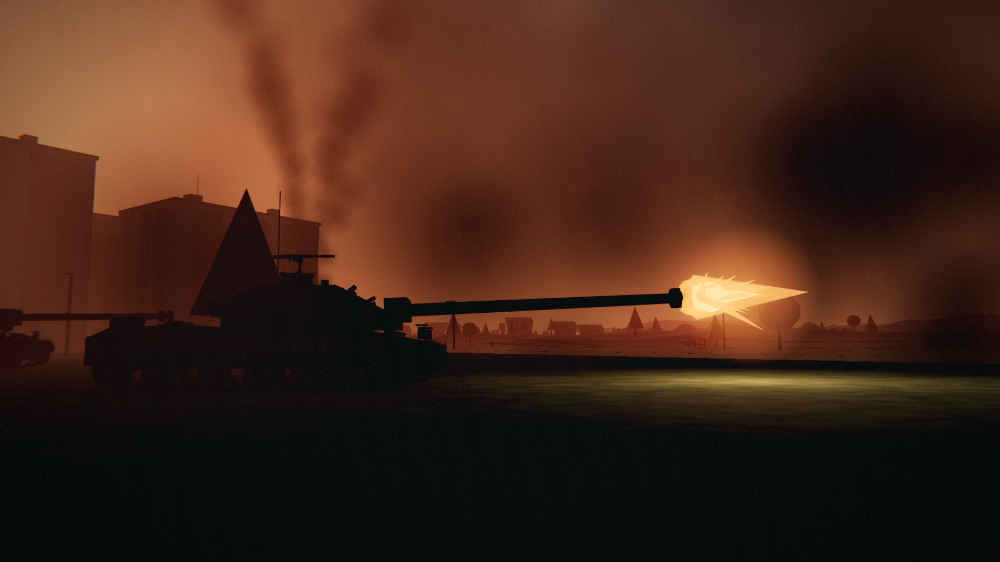
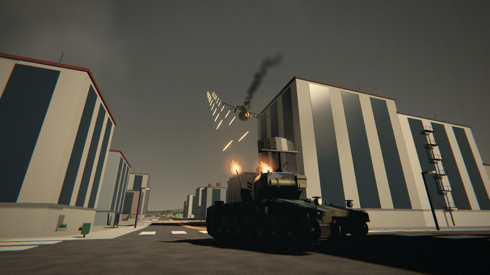
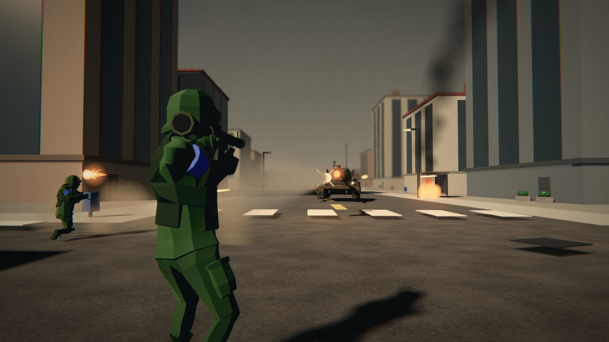

# [REAL] STEEL

**Tanks, aircraft and infantry fighting over a war-torn town.** A free, low-poly combined-arms
shooter for Windows, made in the Godot engine, with bots and online play with friends.

| | |
|---|---|
|  |  |
|  |  |

---

## What is it?

Two teams, Blue and Red, fight over one detailed town set in open country. You choose how to fight
each time you deploy:

- **Drive a tank.** Ten vehicles, from heavy tanks and tank destroyers to artillery, a repair vehicle
  and two anti-aircraft vehicles (the Gepard gun tank and the ADATS missile carrier). Armour,
  penetration, ricochets, modules that break (tracks, gun, engine, ammo) and a gunner's sight.
- **Fly.** Two helicopters (Apache, Mi-8), two jets (Sabre, MiG-15) and two propeller attack planes
  (Skyraider, Il-10), with rockets, bombs, heat-seeking missiles, flares and cockpits.
- **Fight on foot.** Five classes (assault, machine gunner, medic, RPG gunner, engineer) in first or
  third person, with a squad that follows you.

Game modes: **Push** (escort the robot), **Team Deathmatch** and **Domination** (hold three points),
plus a shooting range. There are bots for both teams, a garage with camo and loadouts, levels and XP.

---

## Quick start (for people who know their way round a PC)

1. Go to the **[Releases page](../../releases/latest)** and download `SteelPush-for-friends.zip`
   (about 100 MB; it includes everything, nothing else to install).
2. Right-click the zip > **Properties** > tick **Unblock** > OK. Then **Extract All**.
3. Open the `game` folder and run **REAL STEEL**. If SmartScreen complains: **More info** > **Run anyway**.
4. **F11** (or Alt+Enter) for full screen. For online play, have Steam running, then
   **MULTIPLAYER** > **FIND LOBBIES** (or **OPEN LOBBY** to host).

Windows 10 or 11, 64-bit, with a graphics card from roughly the last ten years.

---

## Step-by-step (if you have never used a PC for much more than Google and memes)

Don't worry, nothing here can break your computer. Take it one step at a time.

**1. Download the game**

- On this page, find the link that says **Releases page** in the Quick start above, and click it.
  (Or look on the right-hand side of the repository's main page for **Releases**.)
- You will see a heading like "v1.0" and a list called **Assets** under it.
- Click **SteelPush-for-friends.zip**. Your browser downloads it. It is about 100 MB, so give it a
  minute.

**2. Find the file you downloaded**

- Press the **Windows key** and **E** together. A window called File Explorer opens.
- On the left, click **Downloads**. You should see **SteelPush-for-friends** there (it has a little
  zipper on its icon).

**3. Tell Windows you trust it**

- **Right-click** the file (press the right mouse button on it, not the left one).
- At the bottom of the list that pops up, click **Properties**.
- A small window opens. At the very bottom, if there is a box called **Unblock**, click it so it has a
  tick. Then click **OK**. (If there is no Unblock box, that is fine, just click OK.)

**4. Unpack it**

- Right-click the file again and click **Extract All...**
- A window opens. Just click **Extract**.
- A new folder opens, also called **SteelPush-for-friends**. That's the game, unpacked.
  (Tip: you can drag this folder onto your Desktop so it is easy to find later.)

**5. Start the game**

- Double-click the folder called **game**.
- Double-click **REAL STEEL** (it has the game's icon).
- The first time, Windows might show a blue box saying **"Windows protected your PC"**. That just
  means Windows has not seen this game before. Click the small words **More info**, then the button
  **Run anyway**.
- The game opens in a window. Press **F11** on your keyboard to make it fill the whole screen
  (press F11 again to go back to a window).

**6. Play**

- Click **SINGLE PLAYER** to play against bots straight away.
- Pick what you want to be (tank, aircraft or soldier) on the deploy screen and click **DEPLOY**.
- Press **Esc** at any time for the pause menu (settings, redeploy, quit).

**7. Play with friends online**

- Everyone needs **Steam** installed, open and signed in (it's free from store.steampowered.com).
- Everyone needs the **same version** of the game, so all download the same zip.
- One person clicks **MULTIPLAYER** > **OPEN LOBBY**. Everyone else clicks **MULTIPLAYER** >
  **FIND LOBBIES** and clicks that lobby.
- Steam will say you are playing "Spacewar". That's normal: it is Steam's free test app, which the
  game borrows until it has a Steam page of its own.

**8. Getting a newer version later**

- Download the new zip from the Releases page and unpack it the same way. You can delete the old
  folder. (Your settings and progress are kept, they are stored separately.)

---

## Controls

All keys can be changed on the **CONTROLS** page of the menu.

| In a tank | | On foot | | In the air | |
|---|---|---|---|---|---|
| W A S D | drive | W A S D | move | Mouse | steer / aim |
| Mouse | aim the turret | Left mouse | fire | W / S | throttle (planes), move (helicopters) |
| Left mouse | fire main gun | Right mouse | aim down sights | Space / Ctrl | climb / descend (helicopters) |
| Right mouse | gunner's sight | Shift | sprint | Left mouse | guns |
| Space | machine gun | Ctrl | crouch | Right mouse | rockets (jets: hold to lock a missile) |
| R | set the range | Z | lie down | F | drop a bomb |
| E | vehicle ability | Space | jump / vault | G | flares |
| C | free look | R | reload | V | cockpit view |
| G | radar on / off (AA) | G | grenade | C | free look |
| T | emotes | 1 2 3 | rifle, pistol, RPG | Z | zoom |
| Middle mouse | ping | V | first / third person | | |

Everywhere: **M** big map, **Tab** scores, **Esc** pause, **F11** full screen.

Leave the battle area (the edge of the map, or far out for aircraft) and a **RETURN TO COMBAT**
countdown starts: get back within 10 seconds.

---

## Trouble?

- **"Windows protected your PC"**: click **More info**, then **Run anyway**.
- **Nothing happens when I double-click**: make sure you extracted the zip first (step 4) and are
  running REAL STEEL from inside the unpacked `game` folder, not from inside the zip.
- **It runs slowly**: on the GRAPHICS page, turn off "Haze that catches the light", then lower
  the sharpness, then set shadows to "near only".
- **Can't see my friend's lobby**: check you both have Steam open and signed in, and both have the
  same version of the game.

---

## For developers

The game is a Godot 4.7.2 project (GDScript, everything built in code from one scene, `main.tscn`).

- Install [Godot 4.7.2](https://godotengine.org/download) (standard, not .NET), open `project.godot`.
- `CLAUDE.md` is the technical log: where everything is, test switches (`--selftest`, `--shot=...`,
  network tests), and a dated history of changes.
- Design data lives in `data/*.json`; models, maps and weapons are generated by the scripts.
- `tools/make_friend_zip.ps1` builds the ready-to-play zip (game + engine) that goes on the Releases page.

## Credits

Made by Mason, built with the help of Claude (Anthropic). Engine: [Godot](https://godotengine.org).
Steam networking: [GodotSteam](https://godotsteam.com). Soldier model: "Soldier" by KolosStudios
(Poly Pizza). Sound credits and licences are listed in `sfx_pack/CREDITS.txt`; some placeholder
sounds there are still to be replaced.
